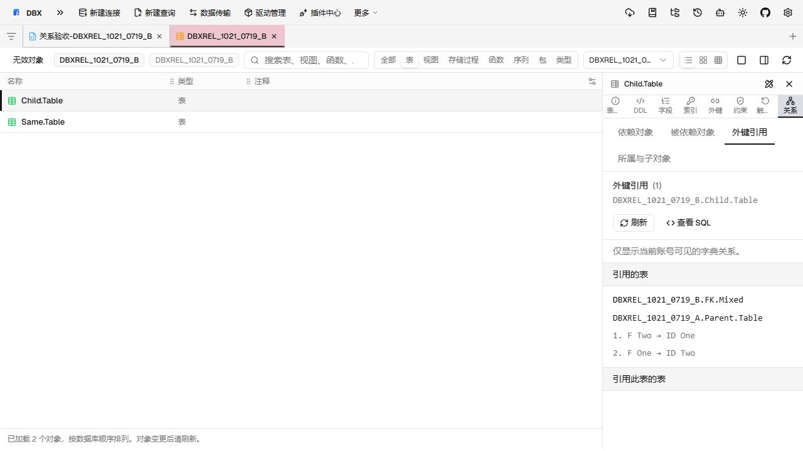

# 查看 Oracle 对象关系

在 Oracle 或 OceanBase Oracle 对象树中，右键过程、函数、程序包或程序包成员，选择「查看依赖关系」。DBX 会打开现有对象详情，直接显示依赖列表；显示为标签页还是弹窗，沿用源码打开方式设置。

表和视图的同一菜单会打开对象浏览器的「关系」属性，不执行表数据查询。在对象浏览器的属性面板、表数据页或查询结果的表属性中，也可以选择「关系」。源码侧面板、源码弹窗和源码标签共用关系查看。

## 在对象详情中切换方向

- **源码**：查看或编辑原有源码。
- **依赖对象**：当前对象直接依赖的对象。
- **被依赖对象**：直接引用当前对象的对象。
- **外键引用**：表引用的表，以及引用此表的表；显示约束名称和按位置配对的列。
- **所属与子对象**：表的索引、触发器，或索引／触发器所属的对象。

只显示当前对象适用的关系种类。表属性不提供源码保存入口；原有外键和索引编辑入口不变。

列表显示名称、类型、Schema 和依赖类型；有远程引用时显示数据库链接。程序包合并显示规范与包体记录，并保留来源类型。包内成员按所属程序包查询，不代表成员级依赖。

切换分区或刷新依赖不会重载源码，也不会清除源码草稿、选区或撤销历史。源码读取失败时，仍可切换到依赖列表独立查询。

## 打开关联对象或查看查询

点击对象名称，按原连接及对象所属 Schema 打开关联表或源码。数据库链接对象、未知类型及当前尚不支持的类型保留在列表中，可复制名称，不会误作本地表打开。

在源码弹窗中打开关联对象前，如果有未保存的修改，DBX 会要求确认是否放弃；取消后保留草稿。

索引关系定位到所属表的只读索引属性，并保留索引自身与所属表的 Schema 和名称。TYPE／TYPE BODY 结果目前可以查看和复制，尚不能从关系列表打开类型管理。

「查看 SQL」在普通查询标签页中生成相应查询，不自动执行。依赖刷新使用独立只读查询，不覆盖源码标签页的 SQL、已有查询结果或手动事务。

## 目录范围与查询状态

列表来自 `ALL_DEPENDENCIES`，仅包含当前账户可见的直接目录记录，不递归展开依赖链。动态 SQL 中的引用可能缺失；空列表表示没有查到当前账户可见的直接记录。

外键关系另从约束和约束列字典读取，不由对象依赖推断。所属关系来自索引和触发器字典。若当前账户只能看到部分外键列或引用目标，列表会保留已知关系并提示不完整，不将其视为完整的列映射。

出向依赖保留远端对象及链接名；通过链接引用的远端同名对象不会计作本地目标的引用者。DBX 不提权补查，也不自动解析同义词或远端链接。

加载、空结果、查询失败及结果截断分别显示。刷新失败时保留上次同一对象的成功结果，并可重试；截断提示表示列表可能不完整。
